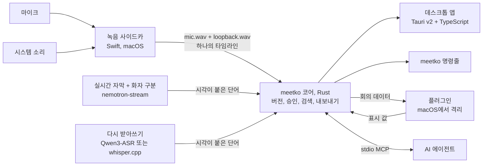

<!-- SPDX-License-Identifier: AGPL-3.0-or-later -->
<div align="center">

# meetko

**한국어·영어 회의 전사본을 내 컴퓨터 안에서.**

단어 단위 타임스탬프를 중심에 둔 로컬 우선 데스크톱 앱입니다.

[](LICENSE)
[](docs/building.md#platform-status)
[](#현재-상태와-한계)
[](Cargo.toml)
[](app/)

[English](README.md) · **한국어**

<sub>릴리스 전 0.1.0 · 소스에서 빌드 · macOS 15 이상 Apple Silicon에서만 확인</sub>

</div>

---

## 왜 meetko인가

회의록은 그 아래 깔린 기록만큼만 믿을 수 있습니다. meetko는 녹음, 전사, 저장, 플러그인 실행을 모두 **내 컴퓨터 안에서**
합니다. 모든 것은 한 가지 계약 위에 있어요: **단어마다 시작·끝 시각(ms)과 화자가 있습니다.**

- 엔진과 모델은 이 데이터를 *만듭니다*. 코어는 이를 **버전**으로 저장하고, 사용자가 검토하고 승인합니다.
- 플러그인과 AI 에이전트는 이 데이터를 *읽고*, 어느 단어에서 나온 것인지 가리키는 결과를 돌려줍니다.
- 모델, 엔진, 플러그인은 모두 [계약](docs/rfc-0001-contract.md)으로 붙어서 서로 바꿔 끼울 수 있습니다.

대상 사용자는 한국어(와 영어)로 일하고, 전사본을 소리와 맞춰 확인하고 싶은 개발자와 기술 팀입니다.

## 할 수 있는 것

- 🎙️ **두 채널 녹음.** 내 목소리(마이크)와 상대 목소리(시스템 소리)를 따로 녹음합니다(macOS).
- ⚡ **실시간 자막이 곧 초안.** 녹음하는 동안 자막이 나오고, 멈추면 바로 검토할 수 있는 초안이 됩니다. 화자 구분 모델이
  있으면 화자도 나눕니다.
- 🎯 **자동 다시 받아쓰기(선택).** 실시간 자막 초안 다음에, 준비된 엔진 중 가장 정확한 것(실험 기능인 Qwen3-ASR, 아니면
  Whisper)으로 녹음 전체를 다시 받아 적어 더 정확한 초안을 만듭니다. 이미 승인한 버전이 있으면 새 초안은 승인해야 기준이
  되고, 엔진이 없으면 실시간 자막 초안만 남습니다.
- ✅ **검토와 승인.** 단어마다 시각이 있어 그 위치의 소리를 바로 들을 수 있고, 고친 결과는 새 버전으로 저장됩니다.
- ✏️ **화자 이름과 문장 고치기.** 화자 이름을 바꾸거나 합치고 문장을 그 자리에서 고칩니다. 원본 위에 덧씌우는 방식이라
  되돌릴 수 있고, 내보내기·검색·MCP에도 반영됩니다.
- 📖 **용어 사전.** Whisper에 넘길 힌트 용어와, 화면·내보내기에 적용할 찾아 바꾸기 목록.
- 📤 **내보내기.** Markdown, 텍스트, SRT, WebVTT 파일로 저장하거나 여러 형태로 복사합니다.
- 🔍 **전체 검색.** 모든 회의의 내용을 앱에서, 또는 `meetko search`로 찾습니다.
- 🔔 **회의 알림**(macOS). 회의 앱이 마이크를 쓰기 시작하면 녹음할지 묻습니다. 스스로 녹음하지 않습니다.
- 🧩 **격리된 플러그인**(macOS). 요약, 액션아이템, 발화 시간 등. API 키는 키체인에 보관합니다.
- 🤖 **MCP 서버.** `meetko mcp`로 Codex CLI, Claude Code 같은 AI 에이전트가 전사본을 읽고 결과를 넣습니다.
- 🧾 **모든 버전과 결과에 출처.** 버전에는 어떤 엔진·모델·파라미터로 만들었는지, 결과에는 어떤 플러그인이나 에이전트가
  어느 전사 버전을 읽고 만들었는지 남깁니다.

기능별 자세한 설명(영어): [docs/how-it-works.md](docs/how-it-works.md)

## 구조

코어는 데스크톱 앱과 명령줄 안에 들어 있는 Rust 라이브러리입니다. 녹음 프로그램, 엔진, 플러그인은 별도 프로세스이고
코어와 프로토콜로만 연결됩니다.



녹음 흐름:


구성 요소 목록과 데이터 계약(영어): [docs/how-it-works.md](docs/how-it-works.md#components)

## 빠르게 시작하기

> [!NOTE]
> 아직 내려받아 바로 설치하는 앱 파일은 없습니다. 소스에서 빌드하고, 엔진은 따로 빌드합니다.
> **macOS 15 이상, Apple Silicon**에서만 끝까지 확인했습니다.

Apple Silicon Mac, Rust, Node.js, Xcode Command Line Tools가 필요하고, 테스트에는 Python 3.12가 필요합니다.

```sh
(cd app && npm ci && npm run build)            # 프런트엔드 먼저
cargo build --workspace                        # 코어와 CLI
(cd capture/macos && swift build -c release)   # 녹음 사이드카
engines/nemotron-stream/fetch-libs.sh && (cd engines/nemotron-stream && cargo build)   # 실시간 자막 엔진
(cd app && npm run tauri dev)                  # 앱 실행
```

그다음 앱에서:

1. 안내 카드나 **설정 › 받아쓰기 준비**에서 **실시간 자막 모델**(742 MB)을 내려받습니다. 화자 구분 모델(107 MB)은
   선택입니다. 파일은 고정된 sha256과 맞아야 씁니다.
2. 녹음을 시작합니다. 처음 한 번 macOS가 마이크와 시스템 오디오 녹음 권한을 묻습니다(화면 내용은 저장하지 않습니다).
3. 멈추면 초안을 검토하고 승인한 뒤 내보내거나 플러그인을 실행합니다.

처음 쓸 때 알아 둘 것:

- 개발 빌드(`npm run tauri dev`)는 저장소 안의 녹음 프로그램(`capture/macos/.build/release/`)과 엔진
  (`engines/nemotron-stream/target/debug/`)을 알아서 찾습니다.
- 모델을 받기 전에 크기, 배포처, 라이선스, 출처를 보여 주고, 끊기면 이어 받습니다. 이미 받은 파일은 "이미 받은 파일
  고르기"로 가져옵니다.
- Whisper로 다시 받아쓰려면 `brew install whisper-cpp`로 설치하고 ggml 모델을 받은 뒤, 데이터 폴더의 `config.toml`에
  `[whisper] model`을 적고 `MEETKO_WHISPER_CLI`를 지정합니다(Finder에서 연 앱은 Homebrew의 PATH를 보지 못합니다).
  설정 화면에도 같은 순서가 나옵니다.

전체 빌드 안내, 선택 엔진, Whisper 설정(영어): [docs/building.md](docs/building.md).
환경변수와 명령줄(영어): [docs/configuration.md](docs/configuration.md).

## 모델

모델은 이 저장소에 없고 앱에도 들어 있지 않으며, meetko가 재배포하지 않습니다. 각 모델은 자기 라이선스를 따릅니다.
쓰기 전에 원 출처의 약관을 확인하세요.

| 용도 | 모델 | 구하는 방법 | 라이선스 |
|---|---|---|---|
| 실시간 자막 (필수) | `nvidia/nemotron-3.5-asr-streaming-0.6b` (q8_0 GGUF, 742 MB) | 앱에서 내려받기 | OpenMDW-1.1 |
| 화자 구분 (선택) | `nvidia/Nemotron-3-Diarization` (q8_0 GGUF, 107 MB) | 앱에서 내려받기 | OpenMDW-1.1 |
| 다시 받아쓰기 (선택) | whisper.cpp용 ggml 모델 (예: `ggml-large-v3-turbo.bin`, Hugging Face `ggerganov/whisper.cpp`) | 직접 받기 | MIT |
| 다시 받아쓰기 (실험 기능, Whisper 대신 고를 수 있음) | `Qwen/Qwen3-ASR-1.7B` + 단어 시각용 `Qwen/Qwen3-ForcedAligner-0.6B` (CrispASR 작성자의 q8_0 GGUF 변환 `cstr/qwen3-asr-1.7b-GGUF`, `cstr/qwen3-forced-aligner-0.6b-GGUF`, 합쳐 약 3.5 GB) | 앱에서 내려받기 (개발용 빌드에서만 엔진이 있음) | Apache-2.0 (엔진 CrispASR는 MIT) |
| 실시간 자막 (예전 엔진) | sherpa-onnx 한국어 streaming zipformer (`sherpa-onnx-streaming-zipformer-korean-2024-06-16`) | 직접 받기 (앱은 제공하지 않음) | 모델 카드에 라이선스 표기 없음. 이름으로 보아 KsponSpeech로 학습했고, 그 데이터의 이용 조건을 따를 수 있음. 연구·시험용으로만 권장 |

사내 측정(합성한 한국어·영어 회의, 문자 오류율 CER, 낮을수록 좋음):

| 엔진 | CER |
|---|---|
| 실시간 자막 | 38.9% |
| Whisper large-v3-turbo | 17.6% |
| Qwen3-ASR | 16.7% (측정한 기기에서 10분 회의에 약 2.5–3분) |

해시 고정, 모델 폴더, 재배포 안내(영어): [docs/building.md](docs/building.md#models-and-pins),
[docs/model-setup.md](docs/model-setup.md)

## 플러그인과 MCP

**플러그인**은 전사본을 받아 화면에 보여 줄 값(요약, 액션아이템, 발화 시간 등)을 돌려주는 별도 프로그램입니다. 목록
저장소는 [Eastsidegunn/meetko-plugins](https://github.com/Eastsidegunn/meetko-plugins)입니다. 이 저장소의 `index.json`이
앱의 **둘러보기** 목록이 되고, 공식 예제(`summary-py`, `action-items-py`, 그리고 둘러보기 목록에는 없는 소스 전용 Rust
예제 `talk-time-rs`)도 하위 폴더로 들어 있습니다. 다른 사람이 만든 플러그인은 각자의 저장소에 두고, meetko-plugins에 PR을
보내 목록에 올립니다. 설치는 정확한 커밋에 고정됩니다.

```sh
meetko plugin install github:OWNER/REPO@REF            # 저장소 루트에 있는 플러그인
meetko plugin install github:OWNER/REPO/SUB/PATH@REF   # 하위 폴더에 있는 플러그인
```

플러그인 id는 `eastsidegunn/summary-py`처럼 생겼고, 앞부분은 저장소 소유자 이름과 같아야 합니다. 목록에 오른다는 것은
형식 검사를 통과했다는 뜻일 뿐 **사람이 코드를 검토하지 않습니다**. 자세한 내용(영어): [docs/plugins.md](docs/plugins.md)

> [!WARNING]
> **보안 주의.** 믿는 플러그인만 설치하세요.
> - **macOS:** 플러그인은 OS 샌드박스(`sandbox-exec`) 안에서 실행됩니다. 네트워크(선언하고 설치 때 동의한 경우만, 그때도
>   IP만 허용), 홈 폴더와 `/Users`, 다른 프로세스 정보, 다른 프로그램 실행, meetko 데이터 폴더, 다른 임시 파일, 외부
>   드라이브를 막고, 쓰기는 실행마다 새로 만드는 임시 HOME에만 허용합니다. 샌드박스를 만들 수 없으면 실행하지 않습니다.
> - **막지 못하는 것:** 플러그인은 여전히 내 컴퓨터에서 실행되고, CPU·메모리는 제한하지 않습니다(시간 제한만 있음).
>   네트워크 권한을 선언한 플러그인은 아무 곳으로나 보낼 수 있으므로, 읽은 것(건네받은 회의 전사본)을 밖으로 보낼 수
>   있습니다. 오디오는 플러그인에 전달하지 않습니다.
> - **Windows·Linux:** 아직 격리가 없습니다. 플러그인은 내 계정 권한으로 실행되고, 매니페스트의 권한은 선언일 뿐입니다.
>
> 알려진 빈틈(영어): [docs/plugin-security.md](docs/plugin-security.md)

**MCP.** `meetko mcp`는 내 컴퓨터에서 stdio로 동작하는 MCP 서버입니다. 이미 쓰는 AI 에이전트(Codex CLI, Claude Code 등)가
회의 목록·전사본(단어 id와 시각)·출처·결과를 읽고, 근거 단어가 달린 결과를 meetko에 넣을 수 있습니다. 에이전트는 자기
로그인으로 AI를 쓰고, meetko는 토큰을 다루지 않습니다. 에이전트가 읽은 전사본은 그 AI 제공자에게 전송되고, 넣은 결과는
앱에서 "외부 AI 에이전트가 만든 결과"로 표시됩니다. 설정: [docs/mcp.md](docs/mcp.md)

## 개인정보와 인터넷 연결

녹음, 전사, 검색, 저장은 모두 기기 안에서 합니다. 앱이 인터넷에 연결하는 것은 **아래 버튼을 누를 때뿐**입니다.
백그라운드 업데이트 확인이나 사용 통계 전송은 없습니다.

| 누르는 것 | 연결하는 곳 |
|---|---|
| 모델 **내려받기** (설정 › 받아쓰기 준비, 또는 회의 목록의 안내) | Hugging Face (`huggingface.co`, 파일은 `*.hf.co`에서 옴) |
| 플러그인 **둘러보기**(`목록 불러오기`)와 **설치** | GitHub (`raw.githubusercontent.com`, `api.github.com`, `codeload.github.com`) |
| 명령줄 `meetko plugin info` / `install github:...` | GitHub |

플러그인이 네트워크를 쓰려면 매니페스트에 선언하고 설치할 때 동의를 받아야 합니다(macOS에서만 강제됩니다). 회의 알림은
어느 프로그램이 마이크를 쓰는지만 보고 그 밖에는 아무것도 보지 않습니다([docs/meeting-detection.md](docs/meeting-detection.md)).
보안 문제 신고는 [SECURITY.md](SECURITY.md)를 보세요.

## 현재 상태와 한계

- **릴리스 전(pre-release), 0.1.0.** 계약, 매니페스트, 화면은 바뀔 수 있습니다. 내려받는 앱 파일은 아직 없고 소스에서
  빌드합니다. 실시간 자막·화자 구분 엔진은 앱에 들어 있지 않습니다.
- **macOS 15 이상, Apple Silicon**에서만 끝까지 확인했습니다.
- **Windows:** CI 설정은 들어 있지만 지금은 꺼 두었습니다. 녹음 프로그램과 회의 알림이 없고, 실제로 써 보지 않았습니다.
- **Linux:** 빌드도 테스트도 하지 않았습니다.
- **플러그인 격리는 macOS에만 있습니다.** 다른 OS에서는 플러그인이 내 계정 권한으로 실행됩니다.
- **알려진 문제**(예: 스피커 소리가 마이크로 들어가 같은 말이 두 번 전사됨)는 [docs/known-issues.md](docs/known-issues.md)에
  있습니다.

## 기여

**가장 쉬운 기여는 플러그인을 만드는 것입니다.** 플러그인은 stdio로 JSON-RPC를 주고받는 작은 프로그램이고(언어는
자유), 전사본을 받아 표시 값을 돌려줍니다. 내 저장소에 두면 되고 meetko를 고칠 필요가 없습니다.
[meetko-plugins](https://github.com/Eastsidegunn/meetko-plugins)의 예제에서 시작해서
[매니페스트 형식](docs/manifest-draft.md)과 [게시 방법](docs/plugin-publishing.md)을 읽고, meetko-plugins에 PR을 보내
목록에 올려 주세요.

meetko 자체에 대한 이슈와 PR도 환영합니다. 큰 변경은 먼저 이슈로 이야기해 주세요. 빌드와 테스트 명령은 [CONTRIBUTING.md](CONTRIBUTING.md)에
있습니다. 계약(`contract/schemas/`, [docs/rfc-0001-contract.md](docs/rfc-0001-contract.md),
[docs/capture-interface.md](docs/capture-interface.md))을 바꾸려면 먼저 RFC 형식의 논의가 필요합니다.
[행동 강령](CODE_OF_CONDUCT.md)을 지켜 주세요.

## 라이선스

[AGPL-3.0-or-later](LICENSE). Copyright (C) 2026 Eastsidegunn.
제3자 소프트웨어·데이터·모델의 라이선스: [THIRD_PARTY_NOTICES.md](THIRD_PARTY_NOTICES.md)
