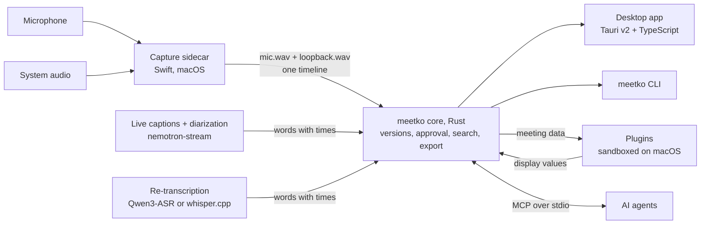
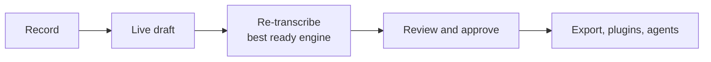

<!-- SPDX-License-Identifier: AGPL-3.0-or-later -->
<div align="center">

# meetko

**Korean–English meeting transcripts, made on your own machine.**

Local-first desktop app with word-level timestamps at its core.

[](LICENSE)
[](docs/building.md#platform-status)
[](#status-and-limitations)
[](Cargo.toml)
[](app/)

**English** · [한국어](README.ko.md)

<sub>Pre-release 0.1.0 · build from source · verified on macOS 15+ with Apple Silicon only</sub>

</div>

---

## Why meetko

Meeting notes are only as good as the record underneath them. meetko records the meeting, transcribes it, stores it
and runs plugins **on your computer**, and treats one thing as the contract everything else builds on: **every word
has a start time, an end time (in ms) and a speaker.**

- Engines and models *produce* that data. The core stores it as **versions** you review and approve.
- Plugins and AI agents *read* it and return results that point back to the exact words they came from.
- Models, engines and plugins attach through a [contract](docs/rfc-0001-contract.md) (Korean), so each can be swapped out.

meetko is built for developers and technical teams who work in Korean (and English) and want a transcript they can
check against the audio.

## Features

- 🎙️ **Two-channel recording.** Your mic and the system audio (the other side) are recorded separately (macOS).
- ⚡ **Live captions become the first draft.** Captions while you record; a reviewable draft the moment you stop,
  with speaker diarization when the model is installed.
- 🎯 **Automatic re-transcription (optional).** After the live draft, the whole recording is transcribed again with
  the most accurate engine that is ready (Qwen3-ASR, experimental, or Whisper) into a more accurate draft. If a
  version is already approved, the new draft waits for your approval; with no engine set up, the live draft stays.
- ✅ **Review and approve.** Every word has a time, so you can jump to the audio at that word. Corrections are saved
  as new versions.
- ✏️ **Speaker names and text edits.** Rename or merge speakers and fix sentences in place, as a reversible layer over
  the original. Edits show up in export, search and MCP.
- 📖 **Custom vocabulary.** Hint terms for Whisper and a find-and-replace list for display and export.
- 📤 **Export.** Markdown, text, SRT and WebVTT, or copy in several forms.
- 🔍 **Full-text search** across all meetings, in the app or with `meetko search`.
- 🔔 **Meeting prompt** (macOS). Asks whether to record when a meeting app starts using the mic. Never records on its
  own.
- 🧩 **Sandboxed plugins** (macOS) for summaries, action items, talk time and more, with API keys kept in the keychain.
- 🤖 **MCP server.** `meetko mcp` lets AI agents such as Codex CLI and Claude Code read transcripts and add results.
- 🧾 **Provenance for every version and result.** A version records the engines, models and parameters that made
  it; a result records the plugin or agent and the transcript version it read.

More detail on each: [docs/how-it-works.md](docs/how-it-works.md).

## How it fits together

The core is a Rust library inside the desktop app and the CLI. Capture, engines and plugins are separate processes
that talk to the core only through a protocol.



The recording flow:



Component list and the data contract: [docs/how-it-works.md](docs/how-it-works.md#components).

## Quick start

> [!NOTE]
> There is no installable app yet. meetko is built from source, and the engines are built separately.
> Verified on **macOS 15+ with Apple Silicon** only.

You need an Apple Silicon Mac, Rust, Node.js, the Xcode Command Line Tools, and Python 3.12 for the tests.

```sh
(cd app && npm ci && npm run build)            # frontend first
cargo build --workspace                        # core and CLI
(cd capture/macos && swift build -c release)   # capture sidecar
engines/nemotron-stream/fetch-libs.sh && (cd engines/nemotron-stream && cargo build)   # live engine
(cd app && npm run tauri dev)                  # run the app
```

Then, in the app:

1. Download the **live-caption model** (742 MB) from the setup card or **Settings › 받아쓰기 준비**. The diarization
   model (107 MB) is optional. Files are checked against pinned sha256 values.
2. Start recording. macOS asks once for microphone and system-audio recording permission (screen contents are not
   saved).
3. When you stop, review the draft, approve it, then export or run plugins.

The app's interface is in Korean for now. Full build notes, optional engines and Whisper setup:
[docs/building.md](docs/building.md). Environment variables and the CLI: [docs/configuration.md](docs/configuration.md).

## Models

Models are **not** in this repository or the app, and meetko does not redistribute them. Each follows its own license;
check the original terms before use.

| Role | Model | How to get it | License |
|---|---|---|---|
| Live captions (required) | `nvidia/nemotron-3.5-asr-streaming-0.6b` (q8_0 GGUF, 742 MB) | Download in the app | OpenMDW-1.1 |
| Diarization (optional) | `nvidia/Nemotron-3-Diarization` (q8_0 GGUF, 107 MB) | Download in the app | OpenMDW-1.1 |
| Re-transcription (optional) | ggml model for whisper.cpp (e.g. `ggml-large-v3-turbo.bin`, Hugging Face `ggerganov/whisper.cpp`) | Download yourself | MIT |
| Re-transcription (experimental, alternative to Whisper) | `Qwen/Qwen3-ASR-1.7B` + `Qwen/Qwen3-ForcedAligner-0.6B` for word times (q8_0 GGUF conversions by the CrispASR author: `cstr/qwen3-asr-1.7b-GGUF`, `cstr/qwen3-forced-aligner-0.6b-GGUF`; about 3.5 GB together) | Download in the app (engine only in development builds) | Apache-2.0 (CrispASR engine: MIT) |
| Live captions (older engine) | sherpa-onnx Korean streaming zipformer (`sherpa-onnx-streaming-zipformer-korean-2024-06-16`) | Download yourself (not offered by the app) | No license on the model card. By its name trained on KsponSpeech, whose terms may apply. Recommended for research and testing only |

Internal measurement on synthetic Korean–English meetings (character error rate, lower is better):

| Engine | CER |
|---|---|
| Live captions | 38.9% |
| Whisper large-v3-turbo | 17.6% |
| Qwen3-ASR | 16.7% (about 2.5–3 min per 10-min meeting on the machine measured) |

Pins, folders and redistribution notes: [docs/building.md](docs/building.md#models-and-pins) and
[docs/model-setup.md](docs/model-setup.md).

## Plugins and MCP

**Plugins** are separate programs that take a transcript and return values to display: a summary, action items, talk
time. The catalog is [Eastsidegunn/meetko-plugins](https://github.com/Eastsidegunn/meetko-plugins): its `index.json`
feeds the app's **Browse** list, and it holds the official examples (`summary-py`, `action-items-py`, and
`talk-time-rs` as a source-only Rust example that is not in the Browse list). Third-party plugins live in their
authors' own repositories and are listed by a pull request to meetko-plugins. Installs are pinned to an exact commit:

```sh
meetko plugin install github:OWNER/REPO@REF            # plugin at the repository root
meetko plugin install github:OWNER/REPO/SUB/PATH@REF   # plugin in a subfolder
```

Plugin ids look like `eastsidegunn/summary-py`; the first part must match the repository owner. Listed plugins pass
format checks only; **nobody reviews their code**. On macOS they run in an OS sandbox; on Windows and Linux they run
with your account's permissions. Read [docs/plugins.md](docs/plugins.md) before installing.

**MCP.** `meetko mcp` is a local stdio MCP server. AI agents you already use (Codex CLI, Claude Code, ...) can read
meetings, transcripts (with word ids and times), provenance and results, and store results that cite the words they
came from. The agent uses its own login; meetko never handles AI tokens. What the agent reads goes to its AI provider,
and its results are marked in the app as made by an external AI agent. Setup: [docs/mcp.md](docs/mcp.md) (Korean,
with an English summary).

## Privacy and network

Recording, transcription, search and storage all happen on your device. The app connects to the internet **only
when you press one of these buttons**. There is no background update check and no telemetry.

| You press | It connects to |
|---|---|
| Model **download** (Settings › 받아쓰기 준비, or the meeting list's setup card) | Hugging Face (`huggingface.co`; files come from `*.hf.co`) |
| Plugin **Browse** (`목록 불러오기`, load list) and **Install** | GitHub (`raw.githubusercontent.com`, `api.github.com`, `codeload.github.com`) |
| CLI `meetko plugin info` / `install github:...` | GitHub |

A plugin that wants the network must declare it in its manifest and get your consent at install time (enforced on
macOS only). The meeting prompt reads only which programs are using the microphone, nothing else
([docs/meeting-detection.md](docs/meeting-detection.md)). To report a security issue, see [SECURITY.md](SECURITY.md).

## Status and limitations

- **Pre-release, 0.1.0.** The contract, manifest and screens may change. No downloadable app yet; build from source.
  The live-caption and diarization engines are not bundled.
- **macOS 15+ on Apple Silicon** is the only platform verified end to end.
- **Windows:** a CI configuration is included but currently turned off. No capture program or meeting prompt, and not
  used for real.
- **Linux:** neither built nor tested.
- **Plugin isolation is macOS only.** Elsewhere plugins run with your account's permissions.
- **Known issues**, for example speaker sound leaking into the mic so the same words are transcribed twice, are in
  [docs/known-issues.md](docs/known-issues.md).

## Contributing

**The easiest way to contribute is to write a plugin.** A plugin is a small program, in any language, that talks
JSON-RPC over stdio: it gets a transcript and returns display values. It lives in your own repository and needs no
change to meetko. Start from the examples in [meetko-plugins](https://github.com/Eastsidegunn/meetko-plugins), read the
manifest format in [docs/manifest-draft.md](docs/manifest-draft.md) (Korean) and the publishing rules in
[docs/plugin-publishing.md](docs/plugin-publishing.md) (Korean, with an English summary), then open a pull request to
meetko-plugins to get listed.

For meetko itself, issues and PRs are welcome; please open an issue before large changes. Build and test commands are
in [CONTRIBUTING.md](CONTRIBUTING.md). Changes to the contract (`contract/schemas/`,
[docs/rfc-0001-contract.md](docs/rfc-0001-contract.md) (Korean), [docs/capture-interface.md](docs/capture-interface.md))
need an RFC-style discussion first. Please follow the [Code of Conduct](CODE_OF_CONDUCT.md).

## License

[AGPL-3.0-or-later](LICENSE). Copyright (C) 2026 Eastsidegunn.
Third-party software, data and model licenses: [THIRD_PARTY_NOTICES.md](THIRD_PARTY_NOTICES.md).
